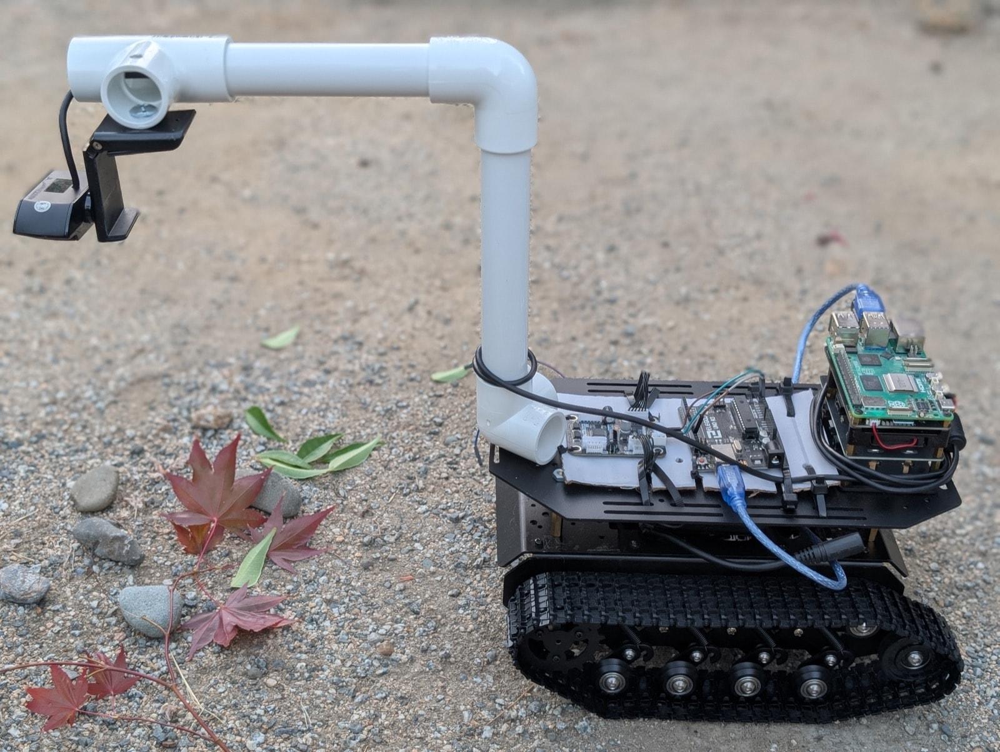

# DuneBroom

DuneBroom is a small, low-cost tracked robot that measures how much trash is
on a beach. It drives back and forth across a marked plot of sand with a
camera looking straight down, photographs the ground, and works out the
**trash density**: how many pieces of litter there are per square meter.

Counting beach litter by hand is slow and inconsistent. DuneBroom aims to
make the survey repeatable, so the same plot can be measured again and
again to see whether pollution is getting better or worse.

## How it works

1. **Set up:** place the rover at the corner of a marked plot and enter the
   plot's size.
2. **Survey:** it drives in back-and-forth lanes, taking photos and tracking
   how far it has moved.
3. **Analyze:** after the drive, a machine-learning model finds the litter in
   the photos, makes sure each piece is counted only once, and reports the
   density along with a map of where items were found.

Everything runs on the robot itself, with no internet connection needed on
the beach.

## Inside

- **Raspberry Pi 5:** the brain. It plans the survey, captures photos and
  runs the analysis.
- **Arduino Uno:** controls the motors and handles safety, stopping the
  robot if anything goes wrong.
- **Two geared track motors** with encoders to measure distance.
- **A downward-facing camera** on a PVC arm.
- **Separate batteries** for the motors and for the Pi.

## Status

In active development. The rover drives and measures distance; next up are
calibration, camera capture and the litter detector. See
[`docs/LOG.md`](docs/LOG.md) for progress.

Project site: [dunebroom.com](https://dunebroom.com)
